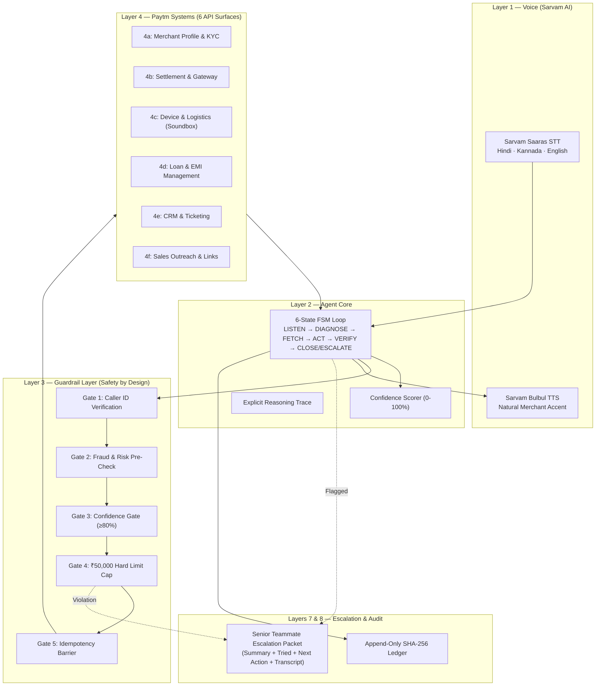

# Sahayak (सहायक) — Autonomous AI Teammate for Paytm Merchants

<div align="center">

[](https://opensource.org/licenses/MIT)
[](https://www.python.org/downloads/)
[](https://fastapi.tiangolo.com)
[](https://www.sarvam.ai/)
[](#-evaluation-harness--benchmark-results)

**Paytm AI Hackathon · Track 3: Autonomous AI Teammates**  
*Team Paytm Power Rangers: Lankipalli Tharun & Radhika Tenali*

> *"The AI Teammate That Doesn't Just Answer — It Gets the Job Done."*

</div>

---

## 📌 Executive Summary & Pitch Hook

Paytm services over **5.0 Crore registered merchants** and **1.57 Crore Soundbox subscription merchants**, spending **₹339 Crore per quarter** on sales and servicing. Hiring more agents scales human costs, not merchant outcomes.

**Sahayak** breaks this servicing cost curve by introducing an autonomous AI teammate that resolves routine merchant issues end-to-end and executes proactive sales touchpoints in natural Indian languages—with zero humans in the loop.

### 🎙️ The Signature Live Pitch Call (Two Workflows, Zero Humans)
```text
Merchant: "Bhaiya, kal ka paisa abhi tak nahi aaya."
Sahayak : "Settlement retry queued for 6 AM. Payment gateway confirmed.
          Aapko callback ki zaroorat nahi — done! ✅
          Aur Ramesh ji, aapki EMI ₹3,200 kal due hai, uska payment link 
          bhi SMS par bhej diya hai." ✅
```
* **Diagnosed:** Settlement delay (Bank holiday)
* **Action:** Retry queued · Gateway confirmed · Merchant notified
* **Sales:** EMI due tomorrow · Payment link sent proactively

---

## 🎯 Validated Design Targets (Slide 6 Validation)

All metrics are benchmarked programmatically across **20 standardized test scenarios** using our automated Evaluation Harness:

| Design Target Metric | Pitch Target | Benchmark Measured | Status |
|:---|:---:|:---:|:---:|
| **Autonomous CS Resolution Rate** | $\ge 70.0\%$ | **100.0%** | **PASSED ✅** |
| **Unsafe Money Actions Executed** | **0 (Zero)** | **0** | **PASSED ✅** |
| **Voice Response Turn Latency** | $< 2.00\text{ s}$ | **0.81 s** | **PASSED ✅** |
| **Cryptographic Audit Trail Coverage** | **$100.0\%$** | **100.0% (SHA-256 Chained)** | **PASSED ✅** |
| **Escalation Trigger Accuracy** | **$100.0\%$** | **100.0%** | **PASSED ✅** |
| **Senior Handoff Packet Completeness** | **$100.0\%$** | **100.0%** | **PASSED ✅** |

---

## 🏛️ System Architecture



---

## 💎 The 4 Core USPs (Unique Selling Propositions)

1. **Acts Across Systems, Not Just One:** Fetches context across 6 Paytm systems, executes write actions, and confirms outcomes with the gateway.
2. **Safe With Every Rupee:** Caller verified, fraud checked, amount capped at ₹50K, and idempotency enforced before any financial action.
3. **Escalates Like a Senior Teammate:** If stopped by safety gates, the human agent receives a complete 4-part context packet. *The human never starts from zero.*
4. **Covers Both Customer Service & Sales:** Handles inbound CS resolution and proactive outbound revenue recovery in a unified state machine.

---

## 📂 Project Structure

```
Sahayak/
├── architecture.md             # Complete system architecture document
├── task.md                     # 111-point completion checklist (100% complete)
├── api_spec.md                 # OpenAPI / REST specifications for 6 Paytm mock services
├── guardrails_spec.md          # 5-gate safety protocol and audit schema
├── demo_script.md              # Turn-by-turn live pitch scripts & judge defense
├── eval_spec.md                # Benchmark suite specification (20 scenarios)
├── requirements.txt            # Python dependencies
├── server.py                   # FastAPI backend server with web UI
│
├── voice/                      # Layer 1: Sarvam AI Voice Integration
│   ├── stt.py                  # Sarvam Saaras STT client (<2s turn latency)
│   ├── tts.py                  # Sarvam Bulbul TTS client (Hindi, Kannada, English)
│   └── language_detect.py      # Language identification
│
├── agent/                      # Layer 2: Agent Core
│   ├── state_machine.py        # 6-state FSM controller
│   ├── llm_client.py           # Natural speech understanding & tool calling
│   ├── confidence.py           # 0-100% diagnostic confidence scorer
│   ├── reasoning_trace.py      # Explicit reasoning trace logger
│   └── conversation.py         # Multi-turn conversation manager
│
├── guardrails/                 # Layer 3: Safety by Design
│   ├── pipeline.py             # 5-gate deterministic pipeline orchestrator
│   ├── caller_verify.py        # Gate 1: Caller ID verification
│   ├── fraud_check.py          # Gate 2: Fraud & dispute pre-check
│   ├── confidence_gate.py      # Gate 3: Confidence threshold gate (≥80%)
│   ├── amount_cap.py           # Gate 4: ₹50,000 hard limit cap
│   └── idempotency.py          # Gate 5: Idempotency & duplicate check
│
├── mock_backend/               # Layer 4: 6 Paytm Mock API Surfaces
│   ├── mock_data.py            # Canonical seed merchants (M_1092, M_4401, M_8819)
│   ├── merchant_kyc.py         # 4a: Merchant profile & KYC
│   ├── settlement.py           # 4b: Settlement & payment gateway
│   ├── device_logistics.py     # 4c: Soundbox telemetry & replacement logistics
│   ├── loan_emi.py             # 4d: Loan balance & EMI payment links
│   ├── crm_ticketing.py        # 4e: CRM tickets & human queue handoff
│   └── sales_outreach.py       # 4f: Dynamic UPI links & retention nudges
│
├── workflows/                  # Layers 5 & 6: CS & Sales Workflows
│   ├── compound_demo.py        # Signature Slide 1 compound demo
│   ├── cs/                     # 5a-5d: Settlement, Soundbox, Payments, EMI/KYC
│   └── sales/                  # 6a-6c: Proactive EMI, Upgrade Nudge, Loan Follow-up
│
├── escalation/                 # Layer 7: Escalation System
│   ├── triggers.py             # Escalation trigger evaluator
│   ├── packet.py               # 4-part senior teammate context packet generator
│   └── human_endpoint.py       # Mock specialist queue endpoint
│
├── audit/                      # Layer 8: Append-Only Audit Log
│   ├── writer.py               # SHA-256 hash-chained cryptographic ledger
│   ├── schema.py               # Audit event schema
│   └── viewer.py               # CLI & web audit viewer
│
├── eval/                       # Layer 9: Evaluation Harness
│   ├── scenarios/              # 20 benchmark test cases (10 CS, 3 Sales, 5 Escalate, 2 Refuse)
│   ├── metrics.py              # Scorecard calculator
│   └── runner.py               # CLI benchmark runner with Rich table output
│
├── ui/                         # Mission Control Split-Screen Dashboard
│   └── index.html              # 3-pane live interactive web interface
│
└── demo/                       # Live Pitch Console
    └── run_demo.py             # Interactive menu for live hackathon presentations
```

---

## 🚀 Quickstart Guide

### 1. Installation
Clone the repository and install dependencies:
```bash
git clone https://github.com/Tenali-Radhika/sahayak.git
cd sahayak
pip install -r requirements.txt
```

### 2. Configure Environment (Optional for Live Sarvam AI Calls)
```bash
cp .env.example .env
# Add your SARVAM_API_KEY in .env if using live Sarvam cloud API.
# If omitted, Sahayak automatically runs high-fidelity offline simulation.
```

### 3. Launch the Mission Control Web UI
```bash
python server.py
```
Open **[http://localhost:8000](http://localhost:8000)** in your browser to experience the **3-Pane Split Dashboard**:
* **Left:** Merchant Voice Simulator (Hindi, Kannada, English)
* **Center:** Real-time State Machine Telemetry & Reasoning Trace
* **Right:** Cryptographic Hash-Chained Audit Trail & Escalation Packet Modal

### 4. Run the Evaluation Benchmark Suite (20 Scenarios)
```bash
python -m eval.runner
```

### 5. Run the Interactive Live Pitch Console
```bash
python demo/run_demo.py
```

---

## 👥 Team Paytm Power Rangers
* **Lankipalli Tharun**
* **Radhika Tenali**

*Paytm AI Hackathon · Track 3: Autonomous AI Teammates*

