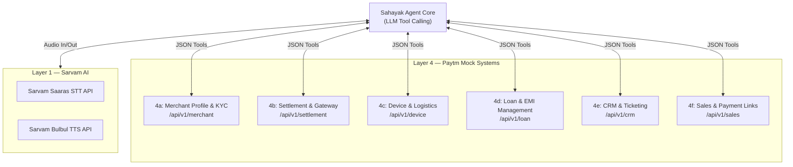

# Sahayak — Mock API & System Integration Specification

### Team Paytm Power Rangers | Lankipalli Tharun · Radhika Tenali
### Paytm AI Hackathon · Track 3: Autonomous AI Teammates

> **Scope:** Full contract definitions for all **6 Paytm Mock API Surfaces** (Layer 4) and the **Sarvam AI Voice Interface** (Layer 1).
> Designed for FastAPI backend implementation with complete type hints and Pydantic schemas.

---

## 1. Architectural Overview of Integration

Sahayak acts as an autonomous operator across 6 distinct Paytm backend systems. Every action is exposed via standard RESTful JSON interfaces that validate caller identity and record all transactions to the append-only audit log.



---

## 2. Layer 1: Sarvam AI Voice Interfaces

### 2.1 Speech-to-Text (STT) — Sarvam Saaras API
* **Endpoint:** `POST https://api.sarvam.ai/speech-to-text`
* **Headers:** `api-subscription-key: <SARVAM_API_KEY>`
* **Content-Type:** `multipart/form-data`
* **Input Parameters:**
  * `file`: Audio file (`.wav` or `.mp3` formatted, 16kHz mono recommended)
  * `language_code`: `hi-IN` (Hindi), `kn-IN` (Kannada), `en-IN` (Indian English), or `unknown` (auto-detect)
  * `model`: `saaras:v1`

#### Response Schema:
```json
{
  "transcript": "Bhaiya, kal ka paisa abhi tak nahi aaya.",
  "language_code": "hi-IN",
  "confidence": 0.98,
  "duration_seconds": 2.4,
  "latency_ms": 420
}
```

### 2.2 Text-to-Speech (TTS) — Sarvam Bulbul API
* **Endpoint:** `POST https://api.sarvam.ai/text-to-speech`
* **Headers:** `api-subscription-key: <SARVAM_API_KEY>`
* **Content-Type:** `application/json`

#### Request Payload:
```json
{
  "inputs": [
    "Aapka settlement retry 6 AM ke liye schedule ho gaya hai. Payment gateway confirmed hai."
  ],
  "target_language_code": "hi-IN",
  "speaker": "meera",
  "pitch": 0.0,
  "pace": 1.05,
  "loudness": 1.5,
  "speech_sample_rate": 8000,
  "enable_preprocessing": true,
  "model": "bulbul:v1"
}
```

#### Response Schema:
```json
{
  "audios": [
    "UklGRiQAAABXQVZFZm10IBAAAAABAAEARKwAAIhYAQACABAAZGF0YQAAAAA="
  ],
  "latency_ms": 510
}
```

---

## 3. Layer 4: Paytm Mock System APIs (6 API Surfaces)

Base URL: `http://localhost:8000/api/v1`

---

### 4a: Merchant Profile & KYC API (`/merchant`)

#### 1. GET `/merchant/{merchant_id}/profile`
Fetches verified merchant details.
* **Response (200 OK):**
```json
{
  "merchant_id": "M_1092",
  "business_name": "Sharma General Store",
  "owner_name": "Ramesh Sharma",
  "phone_number": "+919876543210",
  "registered_address": "Shop 14, Main Market, Indiranagar, Bengaluru",
  "tier": "GOLD",
  "created_at": "2023-01-15T00:00:00Z",
  "is_fraud_flagged": false,
  "active_disputes": 0
}
```

#### 2. GET `/merchant/{merchant_id}/kyc`
Retrieves KYC status, documentation flags, and daily limits.
* **Response (200 OK):**
```json
{
  "merchant_id": "M_1092",
  "kyc_status": "VERIFIED",
  "daily_limit_inr": 200000,
  "monthly_limit_inr": 5000000,
  "pending_documents": [],
  "rejection_reason": null,
  "last_verified_at": "2026-03-10T14:22:00Z"
}
```

#### 3. POST `/merchant/{merchant_id}/kyc/resend-link`
Dispatches a rapid Aadhaar/e-KYC biometric update link to merchant SMS.
* **Request:** `{ "delivery_channel": "WHATSAPP_AND_SMS" }`
* **Response (200 OK):**
```json
{
  "status": "SENT",
  "link_url": "https://paytm.me/kyc/M_1092_reup",
  "expires_in_hours": 24,
  "delivery_id": "MSG_882910"
}
```

---

### 4b: Settlement & Payment Gateway API (`/settlement`)

#### 1. GET `/settlement/{merchant_id}/status`
Fetches pending, in-flight, or held settlement batches.
* **Query Params:** `?date=2026-10-28`
* **Response (200 OK):**
```json
{
  "merchant_id": "M_1092",
  "settlement_id": "SET_99201",
  "batch_date": "2026-10-28",
  "amount_inr": 14250.00,
  "status": "DELAYED",
  "reason_code": "BANK_HOLIDAY",
  "description": "Settlement delayed due to clearing bank Diwali holiday.",
  "scheduled_retry_time": "2026-10-29T06:00:00+05:30",
  "eligible_for_instant_retry": true,
  "risk_hold": false
}
```

#### 2. POST `/settlement/{merchant_id}/retry`
Triggers an autonomous re-clearing run (Enforces Guardrail G1: Must be $\le$ ₹50,000).
* **Request:**
```json
{
  "settlement_id": "SET_99201",
  "requested_amount_inr": 14250.00,
  "bypass_batch": true,
  "priority": "HIGH"
}
```
* **Response (200 OK):**
```json
{
  "status": "QUEUED",
  "job_id": "RETRY_JOB_77812",
  "scheduled_execution": "2026-10-29T06:00:00+05:30",
  "estimated_credit_time": "2026-10-29T06:15:00+05:30",
  "gateway_status": "ACK_RECEIVED"
}
```

#### 3. GET `/settlement/{merchant_id}/retry/confirm`
Verifies backend settlement clearance with the national clearing switch (NPCI / Banking partner).
* **Query Params:** `?job_id=RETRY_JOB_77812`
* **Response (200 OK):**
```json
{
  "job_id": "RETRY_JOB_77812",
  "confirmation_status": "CONFIRMED_PROCESSED",
  "gateway_ack_code": "NPCI_ACK_SUCCESS_200",
  "settlement_reference": "UTR_PAYTM_992837194",
  "merchant_notified": true
}
```

#### 4. POST `/settlement/{merchant_id}/resync-transaction`
Cross-checks gateway logs when a customer’s money was deducted but not shown on merchant Soundbox.
* **Request:** `{ "customer_ref": "UPI_99281729", "approx_amount_inr": 450.00 }`
* **Response (200 OK):**
```json
{
  "sync_status": "RESOLVED_SYNCED",
  "transaction_id": "TXN_77281920",
  "credited_to_merchant": true,
  "soundbox_broadcast_trigger": "SUCCESS",
  "reference_id": "REF_991823"
}
```

---

### 4c: Device & Logistics API (`/device`)

#### 1. GET `/device/{merchant_id}/status`
Queries Soundbox telemetry, 4G SIM connectivity, and battery health.
* **Response (200 OK):**
```json
{
  "merchant_id": "M_1092",
  "device_id": "SBX_4G_88291",
  "model": "Paytm Soundbox 3.0 (4G Voice)",
  "status": "HARDWARE_FAULT",
  "battery_health": "DEGRADED_14_PERCENT",
  "sim_status": "ACTIVE_AIRTEL",
  "last_heartbeat": "2026-10-29T09:12:00+05:30",
  "reported_error": "SPEAKER_COIL_OPEN"
}
```

#### 2. POST `/device/{merchant_id}/replace`
Autonomous order dispatch for hardware replacement.
* **Request:**
```json
{
  "device_id": "SBX_4G_88291",
  "fault_reason": "SPEAKER_FAILURE",
  "delivery_address": "Shop 14, Main Market, Indiranagar, Bengaluru",
  "delivery_speed": "EXPRESS_SAME_DAY"
}
```
* **Response (200 OK):**
```json
{
  "replacement_order_id": "REP_ORD_55419",
  "new_device_serial": "SBX_4G_99014",
  "dispatch_status": "DISPATCHED_FROM_LOCAL_HUB",
  "carrier": "Blue Dart Express",
  "awb_number": "BD_882918201",
  "estimated_delivery": "2026-10-30T14:00:00+05:30"
}
```

#### 3. GET `/device/{merchant_id}/logistics`
* **Query Params:** `?order_id=REP_ORD_55419`
* **Response (200 OK):**
```json
{
  "order_id": "REP_ORD_55419",
  "current_checkpoint": "Out for delivery - Koramangala Hub",
  "delivery_agent_name": "Suresh K",
  "delivery_agent_phone": "+919845012345",
  "eta_human": "Tomorrow before 2:00 PM"
}
```

---

### 4d: Loan & EMI Management API (`/loan`)

#### 1. GET `/loan/{merchant_id}/status`
Retrieves merchant merchant cash advance / credit line health.
* **Response (200 OK):**
```json
{
  "merchant_id": "M_1092",
  "loan_account_id": "LOAN_PL_7721",
  "total_sanctioned_inr": 150000.00,
  "outstanding_balance_inr": 45000.00,
  "daily_deduction_inr": 350.00,
  "next_emi_amount_inr": 3200.00,
  "next_emi_due_date": "2026-10-30",
  "days_past_due": 0,
  "is_npa": false
}
```

#### 2. POST `/loan/{merchant_id}/emi/send-link`
Dispatches proactive payment link via SMS / WhatsApp.
* **Request:** `{ "amount_inr": 3200.00, "installment_num": 7 }`
* **Response (200 OK):**
```json
{
  "payment_link_id": "PLNK_EMI_3321",
  "payment_url": "https://paytm.me/emi/M_1092_07",
  "amount_inr": 3200.00,
  "dispatched_to": "+919876543210",
  "channel": "SMS"
}
```

---

### 4e: CRM & Ticketing API (`/crm`)

#### 1. POST `/crm/ticket/create`
Autonomous incident generation.
* **Request:**
```json
{
  "merchant_id": "M_1092",
  "category": "SETTLEMENT",
  "issue_type": "BANK_HOLIDAY_DELAY",
  "priority": "P2",
  "actions_attempted": ["FETCH_SETTLEMENT", "RETRY_QUEUED", "GATEWAY_CONFIRMED"],
  "resolution_status": "AUTONOMOUSLY_RESOLVED"
}
```
* **Response (200 OK):**
```json
{
  "ticket_id": "TKT_992140",
  "status": "CLOSED",
  "created_at": "2026-10-29T16:20:00Z",
  "closed_at": "2026-10-29T16:20:02Z"
}
```

#### 2. POST `/crm/ticket/escalate`
Hands off complex / flagged issues with zero information loss to human agent queue.
* **Request:**
```json
{
  "merchant_id": "M_8819",
  "escalation_reason": "AMOUNT_EXCEEDS_50K_CAP",
  "issue_summary": "Merchant requesting immediate release of ₹1,20,000 held settlement.",
  "actions_attempted": ["FETCH_PROFILE", "FETCH_SETTLEMENT", "GUARDRAIL_EVALUATED_REJECTED"],
  "next_recommended_action": "Verify bank statement manual credit and route to Risk Desk.",
  "full_transcript": "M: Mera ₹1,20,000 ka settlement ruka hua hai... [full log]",
  "audio_recording_url": "https://storage.paytm.mock/audios/sess_88291.wav"
}
```
* **Response (200 OK):**
```json
{
  "ticket_id": "TKT_ESC_1002",
  "status": "ASSIGNED_TO_SPECIALIST",
  "assigned_queue": "PRIORITY_RISK_SETTLEMENT_DESK",
  "sla_minutes": 15
}
```

---

### 4f: Sales Outreach & Payment Links API (`/sales`)

#### 1. POST `/sales/payment-link/send`
Generates one-click UPI dynamic payment link.
* **Request:**
```json
{
  "merchant_id": "M_1092",
  "purpose": "PROACTIVE_EMI_COLLECTION",
  "amount_inr": 3200.00,
  "short_code": "EMI_OCT26"
}
```
* **Response (200 OK):**
```json
{
  "link_id": "LNK_99812",
  "upi_intent_uri": "upi://pay?pa=paytm.collection@icici&pn=PaytmLending&am=3200.00&tr=PLNK_EMI_3321",
  "web_url": "https://paytm.me/emi/3321",
  "sent_via": "SMS"
}
```

#### 2. POST `/sales/nudge/trigger`
Proactive retention or upgrade nudges.
* **Request:**
```json
{
  "merchant_id": "M_1092",
  "campaign_type": "SOUNDBOX_4G_UPGRADE",
  "discount_offer_code": "RETENTION_50_OFF"
}
```
* **Response (200 OK):**
```json
{
  "campaign_id": "CMP_7719",
  "dispatched": true,
  "offer_text": "Upgrade to Soundbox 4G at 50% discount applied."
}
```

---

## 4. Mock Database Seed Data

For demo and testing reliability, three canonical merchant profiles are pre-seeded:

| Merchant ID | Name / Store | Scenario Focus | Pre-configured State |
|-------------|--------------|----------------|----------------------|
| `M_1092` | Ramesh Sharma (`Sharma General Store`) | **Signature Live Pitch Demo (Slide 1)** | Delayed ₹14,250 settlement (Bank Holiday) + EMI ₹3,200 due tomorrow + Soundbox active |
| `M_4401` | Ananya Patel (`Patel Electronics`) | **Soundbox Failure & Device Demo** | Faulty Soundbox (Speaker coil blown) + Active Gold KYC |
| `M_8819` | Vikram Singh (`Singh Traders`) | **Safety & Escalation Demo (Guardrails)** | Settlement ₹1,20,000 (Exceeds ₹50K cap) OR Fraud Flag active |

---

*Specification verified against all requirements in `Sahayak_Paytm_Power_Rangers_V2.pptx` (Slide 4, 6 APIs) and `architecture.md` Layer 4.*

