# Sahayak — System Architecture

### Team Paytm Power Rangers | Lankipalli Tharun · Radhika Tenali
### Paytm AI Hackathon · Track 3: Autonomous AI Teammates

> **"The AI Teammate That Doesn't Just Answer — It Gets the Job Done."**

---

## Table of Contents

1. [Problem Context](#1-problem-context)
2. [High-Level Architecture](#2-high-level-architecture)
3. [Layer 1 — Voice Layer (Sarvam AI)](#3-layer-1--voice-layer-sarvam-ai)
4. [Layer 2 — Agent Core (State Machine + LLM)](#4-layer-2--agent-core-state-machine--llm)
5. [Layer 3 — Guardrail Layer (Safety by Design)](#5-layer-3--guardrail-layer-safety-by-design)
6. [Layer 4 — Paytm Mock System Integrations (6 API Surfaces)](#6-layer-4--paytm-mock-system-integrations-6-api-surfaces)
7. [Layer 5 — Customer Service Workflows](#7-layer-5--customer-service-workflows)
8. [Layer 6 — Sales Workflows (Proactive Outreach)](#8-layer-6--sales-workflows-proactive-outreach)
9. [Layer 7 — Escalation System](#9-layer-7--escalation-system)
10. [Layer 8 — Audit Log](#10-layer-8--audit-log)
11. [Layer 9 — Evaluation Harness](#11-layer-9--evaluation-harness)
12. [End-to-End Data Flow](#12-end-to-end-data-flow)
13. [USP ↔ Architecture Traceability](#13-usp--architecture-traceability)
14. [Impact & Design Targets](#14-impact--design-targets)
15. [Business Model Alignment](#15-business-model-alignment)
16. [Directory Structure](#16-directory-structure)

---

## 1. Problem Context

> **PPT Claim (Slide 2):** *"Merchant servicing is breaking under its own weight — and more agents is not the answer."*

| Metric | Value | Source |
|--------|-------|--------|
| Registered merchants | 5.0 Cr | Paytm Q1 FY27 |
| Device-subscription merchants | 1.57 Cr (↑27 lakh YoY) | Paytm Q1 FY27 |
| Sales & service cost per quarter | ₹339 Cr (growing faster than merchant base) | Paytm Q1 FY27 |

**Top ticket categories Sahayak must resolve:**

| Category | Volume Share | Merchant Says |
|----------|-------------|---------------|
| Settlement delays | ~40% | *"Kal ka paisa nahi aaya"* |
| Soundbox failures | ~25% | *"Soundbox bol nahi raha"* |
| Failed payments | ~20% | *"Paise kat gaye, mujhe nahi mile"* |
| EMI & KYC blocks | ~15% | *"Mera account limit ho gaya"* |

**Architecture implication:** The system must handle all four categories end-to-end — from voice intake through multi-system action to resolution or escalation — without requiring a human for routine cases.

---

## 2. High-Level Architecture

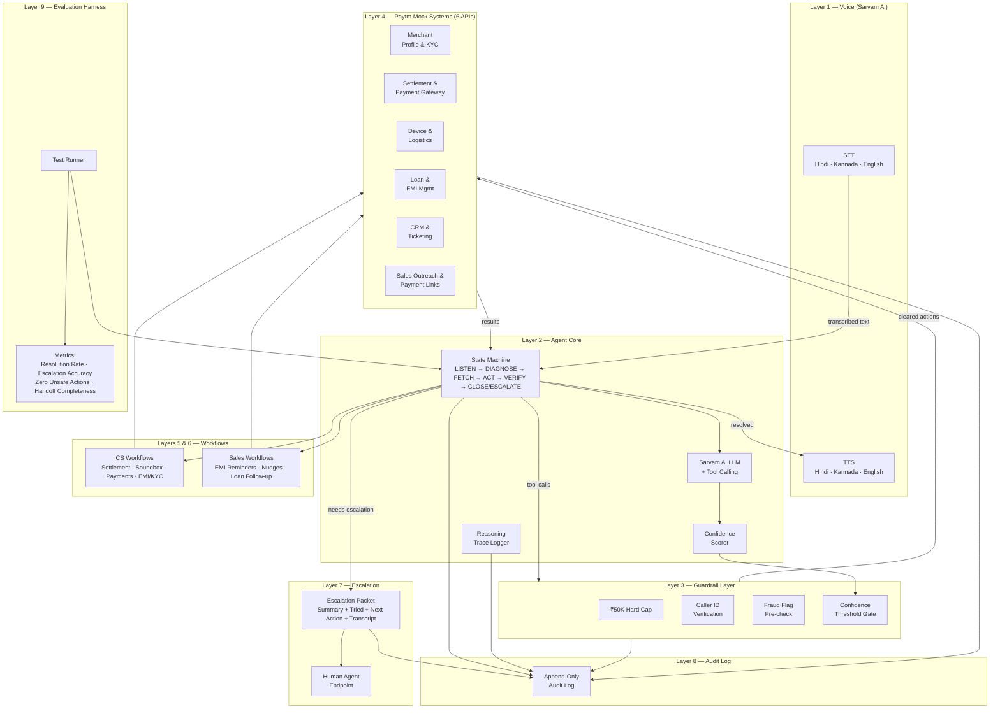

> **PPT Claim (Slide 3):** *"One AI teammate — end-to-end ownership across customer service AND sales."*
>
> ✅ **Architecture answer:** A single Agent Core (Layer 2) drives both CS workflows (Layer 5) and Sales workflows (Layer 6) through the same state machine, guardrails, and backend integrations.

---

## 3. Layer 1 — Voice Layer (Sarvam AI)

> **PPT Claim (Slide 4):** *"Speech-to-text and text-to-speech for Hindi, Kannada and English. Purpose-built for Indian merchant speech patterns. Sub-2s latency per turn."*

### Architecture

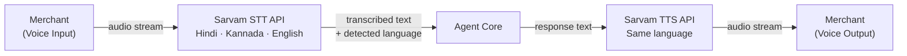

### Components

| Component | Technology | Responsibility |
|-----------|-----------|----------------|
| **STT (Speech-to-Text)** | Sarvam AI STT API | Transcribe merchant audio input to text |
| **TTS (Text-to-Speech)** | Sarvam AI TTS API | Convert Sahayak's text response to audio |
| **Language Detection** | Sarvam AI auto-detect | Identify Hindi / Kannada / English from speech |
| **Latency Budget** | Target < 2 seconds | End-to-end per-turn voice response time |

### Claim Traceability

| Claim | Architecture Element | How It's Fulfilled |
|-------|---------------------|-------------------|
| Hindi, Kannada, English support | STT + TTS with multilingual config | Each Sarvam API call specifies language; auto-detect selects correct model |
| Indian merchant speech patterns | Sarvam AI (official AI partner) | Sarvam's models are purpose-built for Indian languages & accents |
| Sub-2s latency per turn | Pipeline: STT → Agent → TTS | Latency budget allocated: STT ~500ms, Agent ~800ms, TTS ~500ms, overhead ~200ms |

---

## 4. Layer 2 — Agent Core (State Machine + LLM)

> **PPT Claim (Slide 4):** *"State-machine loop: Diagnose → Decide → Act → Verify. Confidence score on every step. Explicit reasoning trace — not a black box."*

### State Machine

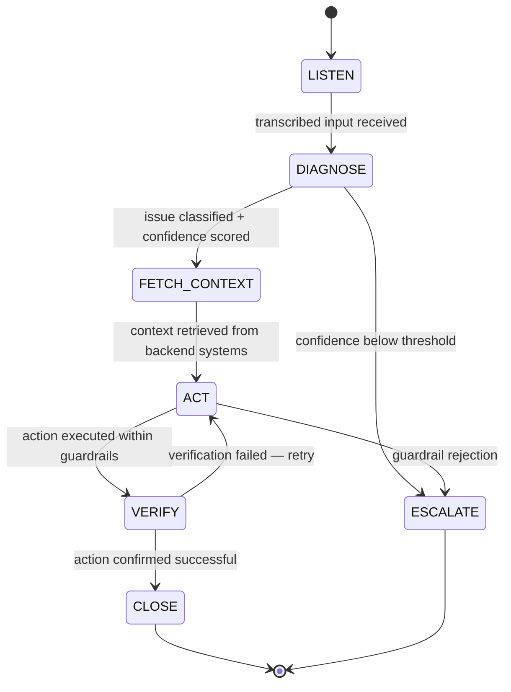

### Components

| Component | Responsibility | Implementation Detail |
|-----------|---------------|----------------------|
| **State Machine Controller** | Orchestrates the 6-state loop | Explicit state transitions; no implicit jumps |
| **Sarvam AI LLM** | Issue classification, reasoning, response generation | Tool calling / function calling for backend actions |
| **Confidence Scorer** | Assigns 0–100 score at DIAGNOSE | Below threshold → auto-escalate, never act |
| **Reasoning Trace Logger** | Records full chain-of-thought per turn | Every step logged: input → reasoning → decision → output |
| **Multi-turn Handler** | Maintains conversation context across turns | Merchant can ask follow-up questions; context persists |

### 6 Explicit States

| # | State | What Happens | Output |
|---|-------|-------------|--------|
| 1 | **LISTEN** | Receive and transcribe merchant audio via Sarvam STT | Raw text + detected language |
| 2 | **DIAGNOSE** | LLM classifies issue type, scores confidence | Issue category + confidence (0–100) |
| 3 | **FETCH CONTEXT** | Pull data from relevant mock Paytm systems | Structured data from 1+ of 6 API surfaces |
| 4 | **ACT** | Execute tool call within guardrails | Action result (success / blocked / failed) |
| 5 | **VERIFY** | Confirm action actually succeeded (gateway confirmation, ticket ID, etc.) | Verified ✅ or retry loop |
| 6 | **CLOSE / ESCALATE** | Resolve with merchant OR hand off to human with full context | Audit log entry + TTS response or escalation packet |

### Claim Traceability

| Claim | Architecture Element | How It's Fulfilled |
|-------|---------------------|-------------------|
| State-machine loop | 6-state FSM controller | Explicit states with defined transitions; loops back on verify failure |
| Confidence score on every step | Confidence Scorer at DIAGNOSE | Numeric 0–100 score; below threshold → ESCALATE |
| Explicit reasoning trace | Reasoning Trace Logger | Full chain logged to audit; inspectable at any time — **not a black box** |
| LLM tool calling | Sarvam AI LLM + function calling interface | LLM emits structured tool calls; controller routes to mock backend |

---

## 5. Layer 3 — Guardrail Layer (Safety by Design)

> **PPT Claim (Slide 4):** *"₹50K hard cap on financial actions · Caller ID verification before acting · Fraud flag pre-check · Append-only audit log · Confidence threshold gate"*

### Guardrail Pipeline

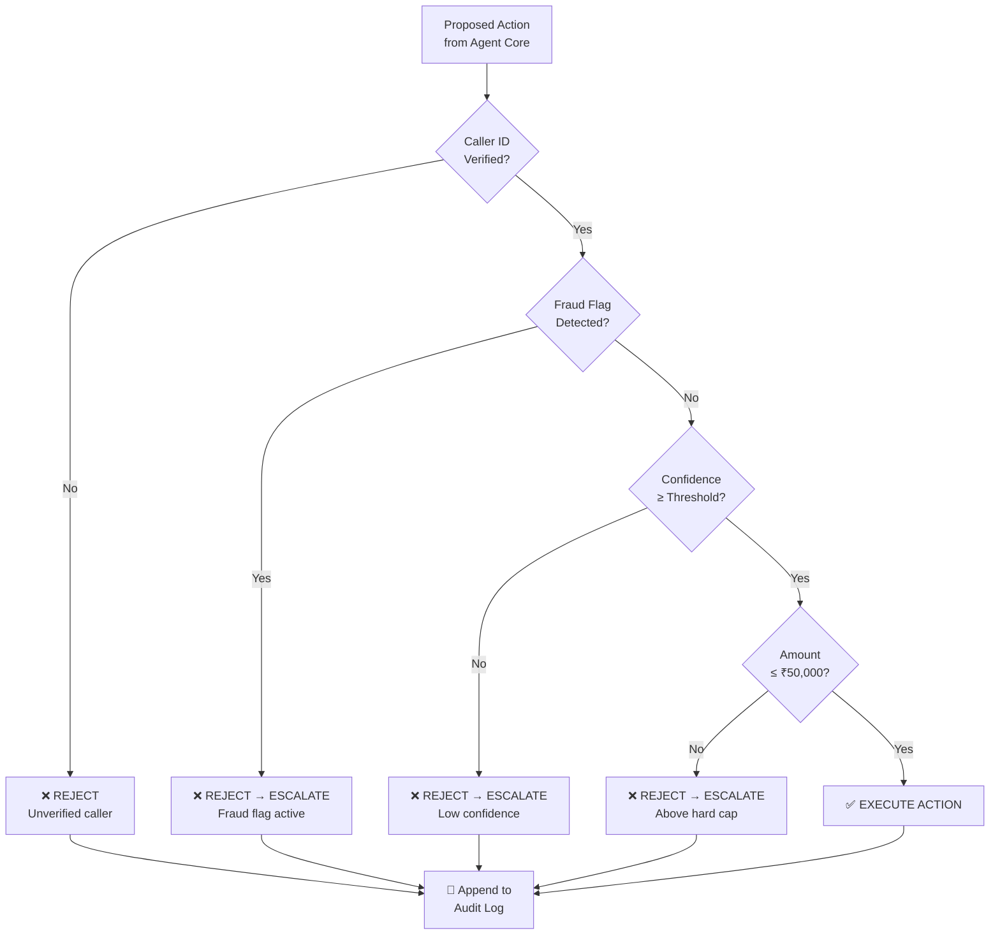

### Guardrail Rules

| # | Guardrail | Rule | On Violation |
|---|-----------|------|-------------|
| G1 | **₹50,000 Hard Cap** | No financial action above ₹50K executes — no override, no exception | Reject + auto-escalate to human |
| G2 | **Caller ID Verification** | Merchant ID must match mock DB record before any action | Reject + log reason |
| G3 | **Fraud Flag Pre-check** | System checks fraud flags before every financial action | Reject + auto-escalate with fraud alert |
| G4 | **Confidence Threshold Gate** | If diagnosis confidence < configured threshold → do not act | Reject + escalate (agent unsure) |
| G5 | **Append-Only Audit Log** | Every action (attempted, completed, rejected) is logged; no deletes or edits | Immutable record — always written |

### Claim Traceability

| Claim | Architecture Element | How It's Fulfilled |
|-------|---------------------|-------------------|
| ₹50K hard cap | Guardrail G1 | Amount check before every financial tool call; hard-coded, non-configurable |
| Caller ID verification | Guardrail G2 | Merchant ID validated against mock profile DB at pipeline entry |
| Fraud flag pre-check | Guardrail G3 | Fraud status queried from mock system; flagged → instant escalation |
| Append-only audit log | Guardrail G5 | Log is insert-only; no UPDATE/DELETE operations exposed |
| Confidence threshold gate | Guardrail G4 | Confidence score from Layer 2 checked; below threshold → ESCALATE |

---

## 6. Layer 4 — Paytm Mock System Integrations (6 API Surfaces)

> **PPT Claim (Slide 4):** *"Merchant profile & KYC · Settlement & payment gateway · Device & logistics (Soundbox) · Loan & EMI management · CRM & ticketing · Sales outreach & payment links"*

### API Surface Map

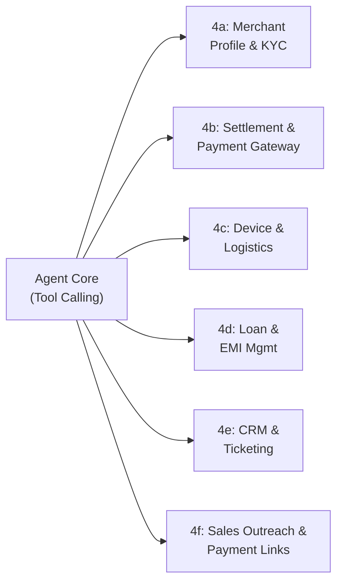

### 4a — Merchant Profile & KYC API

| Method | Endpoint | Purpose |
|--------|----------|---------|
| `GET` | `/merchant/{id}/profile` | Retrieve merchant profile by ID |
| `GET` | `/merchant/{id}/kyc` | Get KYC status (verified / pending / blocked) |
| `POST` | `/merchant/{id}/kyc/update` | Update KYC status (for completion flow) |

### 4b — Settlement & Payment Gateway API

| Method | Endpoint | Purpose |
|--------|----------|---------|
| `GET` | `/settlement/{merchant_id}/status` | Settlement status for a date/transaction |
| `GET` | `/settlement/{merchant_id}/delay-reason` | Reason for delay (bank holiday, T+1, risk hold) |
| `POST` | `/settlement/{merchant_id}/retry` | Retry settlement (within ₹50K guardrail) |
| `GET` | `/settlement/{merchant_id}/retry/confirm` | Confirm retry succeeded via gateway |

### 4c — Device & Logistics API (Soundbox)

| Method | Endpoint | Purpose |
|--------|----------|---------|
| `GET` | `/device/{merchant_id}/status` | Device status (active / faulty / offline) |
| `POST` | `/device/{merchant_id}/replace` | Raise Soundbox replacement request |
| `GET` | `/device/{merchant_id}/logistics` | Track replacement logistics |

### 4d — Loan & EMI Management API

| Method | Endpoint | Purpose |
|--------|----------|---------|
| `GET` | `/loan/{merchant_id}/status` | Loan status and outstanding amount |
| `GET` | `/loan/{merchant_id}/emi` | EMI due date and amount |
| `POST` | `/loan/{merchant_id}/emi/send-link` | Send EMI payment link to merchant |
| `GET` | `/loan/{merchant_id}/block-reason` | Account limit/block reason |

### 4e — CRM & Ticketing API

| Method | Endpoint | Purpose |
|--------|----------|---------|
| `POST` | `/crm/ticket/create` | Create ticket with full context (issue, actions tried, next step) |
| `GET` | `/crm/ticket/{ticket_id}/status` | Get ticket ID and current status |
| `POST` | `/crm/ticket/{ticket_id}/escalate` | Escalate ticket to human agent with full transcript |

### 4f — Sales Outreach & Payment Links API

| Method | Endpoint | Purpose |
|--------|----------|---------|
| `POST` | `/sales/payment-link/send` | Send payment link via SMS / WhatsApp (mock) |
| `GET` | `/sales/payment-link/{link_id}/status` | Payment link status (opened / completed / pending) |
| `POST` | `/sales/nudge/trigger` | Trigger proactive merchant nudge (low usage, upgrade offer) |

### Claim Traceability

> **PPT Claim (Slide 5 — USP #1):** *"Fetches data from 6 Paytm systems, takes action, and confirms the outcome — not a lookup, a resolution."*

| Claim | Architecture Element | How It's Fulfilled |
|-------|---------------------|-------------------|
| 6 API surfaces | APIs 4a–4f | Each system modeled as a separate mock service with GET/POST endpoints |
| Not just lookup — resolution | POST actions + GET confirmations | Agent doesn't just read data; it **acts** (retry, replace, send link) and **verifies** (confirmation endpoint) |
| Multi-system action | Agent Core tool calling | Single agent call can touch multiple APIs in sequence (e.g., fetch settlement → retry → confirm) |

---

## 7. Layer 5 — Customer Service Workflows

> **PPT Claim (Slide 3):** *"Resolves on its own — CS: Retries failed settlements, confirms with gateway. Raises Soundbox replacements, gives tracking info. Re-syncs missing transactions. Sends payment, EMI and KYC links."*

### 5a — Settlement Delays (~40% of tickets)

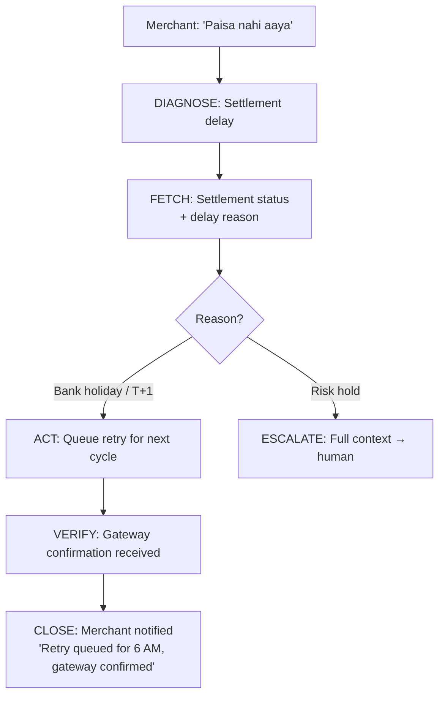

**APIs used:** 4b (Settlement & Payment Gateway)

### 5b — Soundbox Failures (~25% of tickets)

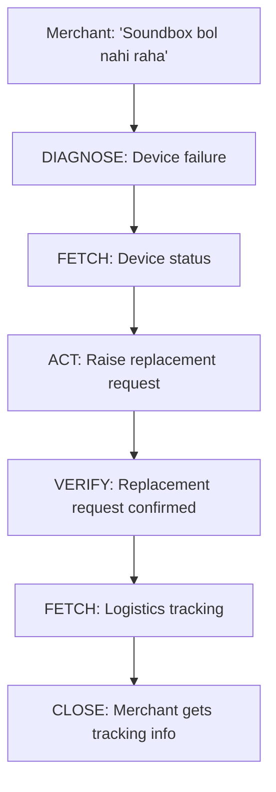

**APIs used:** 4c (Device & Logistics)

### 5c — Failed / Missing Payments (~20% of tickets)

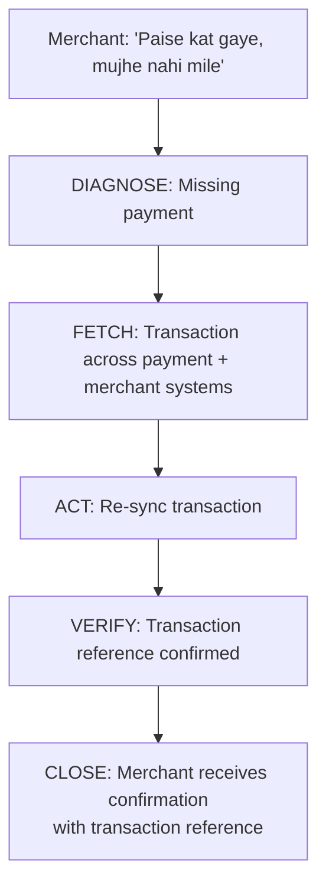

**APIs used:** 4b (Settlement & Payment Gateway), 4a (Merchant Profile)

### 5d — EMI & KYC Issues (~15% of tickets)

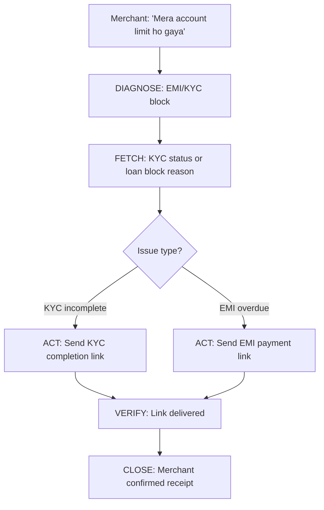

**APIs used:** 4a (Merchant Profile & KYC), 4d (Loan & EMI Management)

---

## 8. Layer 6 — Sales Workflows (Proactive Outreach)

> **PPT Claim (Slide 3):** *"Sales: Proactive EMI reminders + payment link delivery"*
> **PPT Claim (Slide 5 — USP #4):** *"Handles inbound resolution (CS) and outbound proactive action (Sales) — EMI follow-up, payment nudges, upsell triggers — in one framework."*

### Proactive Trigger Architecture

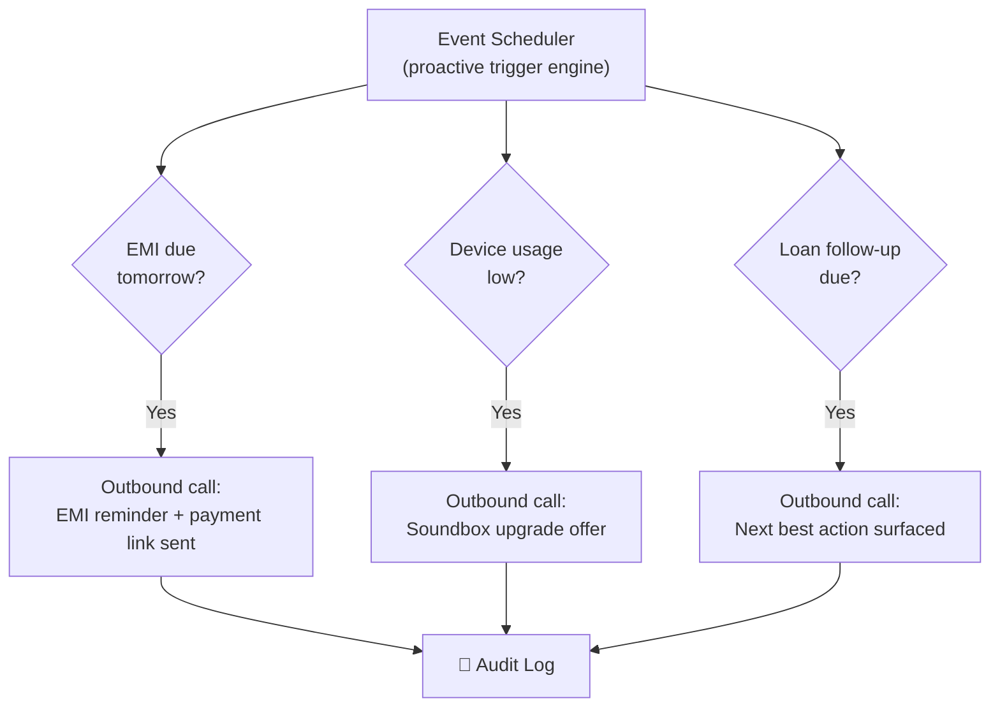

### Sales Workflow Details

| Workflow | Trigger | Action | APIs Used |
|----------|---------|--------|-----------|
| **EMI Reminder** | EMI due date detected (D-1) | Proactive outreach → send payment link | 4d (Loan & EMI), 4f (Sales) |
| **Low Usage Nudge** | Device usage below threshold | Merchant nudged with Soundbox upgrade offer | 4c (Device), 4f (Sales) |
| **Loan Follow-up** | Loan status requires action | Next best action identified and surfaced | 4d (Loan & EMI), 4f (Sales) |

### Claim Traceability

| Claim | Architecture Element | How It's Fulfilled |
|-------|---------------------|-------------------|
| Proactive EMI reminders + payment link delivery | EMI Reminder workflow | Scheduler detects due date → outbound call → payment link via 4f API |
| Low usage nudge — Soundbox upgrade offer | Low Usage Nudge workflow | Usage analytics trigger → outbound call with upgrade offer |
| Loan follow-up — next best action surfaced | Loan Follow-up workflow | Loan status check → intelligent next-step recommendation |
| Sales + CS in one framework | Same Agent Core (Layer 2) | Both inbound (CS) and outbound (Sales) go through identical state machine, guardrails, and audit |

---

## 9. Layer 7 — Escalation System

> **PPT Claim (Slide 5 — USP #3):** *"Human receives: issue summary, what Sahayak tried, next recommended action, full transcript. The human never starts from zero."*

### Escalation Triggers

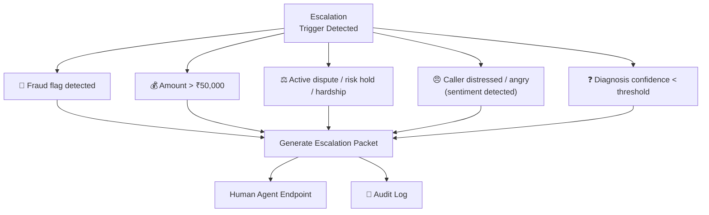

> **PPT Claim (Slide 3):** *"Sahayak knows when NOT to act — that's a feature, not a fallback."*

### Escalation Packet Contents

| Field | Content | Purpose |
|-------|---------|---------|
| **Issue Summary** | What the merchant reported | Human understands the problem immediately |
| **Actions Tried** | What Sahayak attempted (with outcomes) | Human knows what's already been done |
| **Next Recommended Action** | Sahayak's suggestion for the human | Human has a starting point, not a blank slate |
| **Full Transcript** | Complete voice-to-text conversation log | Human has full context — **never starts from zero** |
| **Escalation Reason** | Which trigger fired (fraud, amount, confidence, etc.) | Human knows *why* Sahayak stopped |

### Escalation Trigger Rules

| Trigger | Condition | Rationale |
|---------|-----------|-----------|
| Fraud flag | `merchant.fraud_flag == true` | Never act on flagged accounts — safety first |
| Amount cap | `action.amount > 50000` | ₹50K hard limit — no financial action above this |
| Active dispute | `merchant.dispute_status == 'active'` | Legal/compliance risk — human judgment required |
| Risk hold | `settlement.hold_reason == 'risk'` | Risk team must review — AI should not override |
| Hardship case | `merchant.hardship_flag == true` | Sensitive situation — human empathy needed |
| Caller distress | Sentiment analysis detects anger/distress | Emotional situations need human handling |
| Low confidence | `diagnosis.confidence < threshold` | Agent unsure — better to escalate than guess |

---

## 10. Layer 8 — Audit Log

> **PPT Claim (Slide 6):** *"100% of actions audit-logged — zero exceptions"*

### Audit Log Architecture

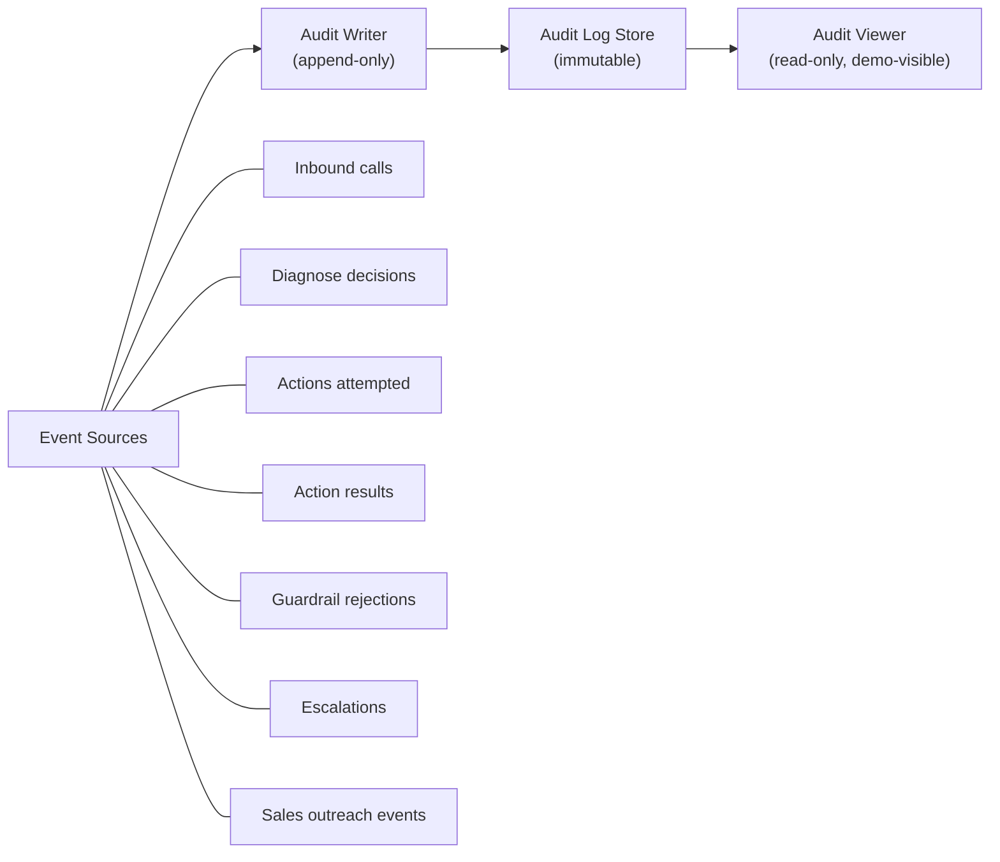

### Log Entry Schema

| Field | Type | Description |
|-------|------|-------------|
| `timestamp` | ISO 8601 | When the event occurred |
| `event_id` | UUID | Unique identifier for this log entry |
| `merchant_id` | string | Which merchant this relates to |
| `session_id` | UUID | Conversation session identifier |
| `event_type` | enum | `CALL_INBOUND`, `DIAGNOSE`, `ACTION_ATTEMPT`, `ACTION_RESULT`, `GUARDRAIL_REJECT`, `ESCALATION`, `SALES_OUTREACH` |
| `action_type` | string | Specific action (e.g., `settlement_retry`, `device_replace`) |
| `parameters` | object | Action parameters (amounts, IDs, etc.) |
| `guardrail_outcome` | enum | `PASSED`, `REJECTED_AMOUNT`, `REJECTED_FRAUD`, `REJECTED_CONFIDENCE`, `REJECTED_IDENTITY` |
| `result` | enum | `SUCCESS`, `FAILURE`, `ESCALATED` |
| `confidence_score` | number | Diagnosis confidence (0–100) |
| `reasoning_trace` | string | LLM reasoning chain for this step |

### Immutability Guarantees

| Property | Implementation |
|----------|---------------|
| **Append-only** | No `UPDATE` or `DELETE` operations exposed in the API |
| **Write-on-every-event** | Every event source writes through the Audit Writer — no bypasses |
| **Zero exceptions** | Guardrail rejections, escalations, and even failed actions are all logged |
| **Demo-visible** | Audit Viewer provides real-time log display during live demo |

---

## 11. Layer 9 — Evaluation Harness

> **PPT Claim (Slide 4):** *"Test scenarios covering CS + Sales workflows. Measures: resolution rate, escalation accuracy, zero unsafe actions, handoff completeness. To be demonstrated at the offline hackathon."*

### Evaluation Architecture

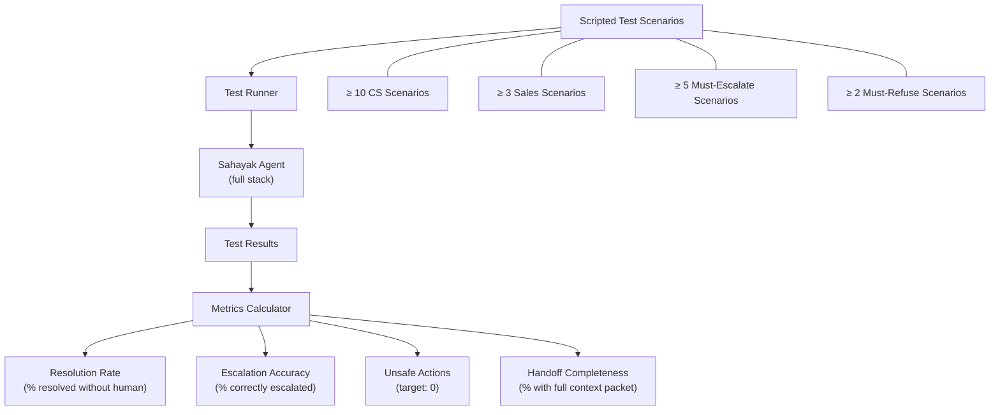

### Test Scenario Categories

| Category | Min Scenarios | What's Tested |
|----------|--------------|--------------|
| **CS — Settlement delays** | 3+ | Retry, bank holiday, risk hold escalation |
| **CS — Soundbox failures** | 2+ | Replace, logistics tracking |
| **CS — Failed payments** | 2+ | Re-sync, transaction confirmation |
| **CS — EMI/KYC** | 3+ | Payment link, KYC link, block reason |
| **Sales — Proactive outreach** | 3+ | EMI reminder, low usage nudge, loan follow-up |
| **Must-escalate** | 5+ | Fraud, high amount, dispute, distress, low confidence |
| **Must-refuse** | 2+ | Unsafe action attempts (e.g., above cap, unverified) |

### Design Target Metrics

| Metric | Target | Measurement |
|--------|--------|-------------|
| **Resolution rate** | 70%+ routine CS tickets | `(resolved_without_human / total_routine) × 100` |
| **Unsafe actions executed** | 0 | Count of actions that bypassed guardrails |
| **Voice response latency** | < 2 seconds/turn | STT + Agent + TTS pipeline time |
| **Audit log coverage** | 100% | `(logged_events / total_events) × 100` |
| **Escalation accuracy** | 100% of must-escalate cases | `(correctly_escalated / should_have_escalated) × 100` |
| **Handoff completeness** | 100% of escalations | `(escalations_with_full_packet / total_escalations) × 100` |

---

## 12. End-to-End Data Flow

### 12.1 Signature Live Pitch Flow: Dual CS + Sales in a Single Call (Slide 1)
> **The Exact Hackathon Winning Scenario:** Merchant calls with an urgent settlement issue. Sahayak diagnoses, clears guardrails, retries the settlement, confirms with the gateway, resolves the merchant's concern, and *in the same breath* checks merchant profile, identifies an EMI due tomorrow, and delivers the payment link proactively before closing. **Two workflows, zero humans.**

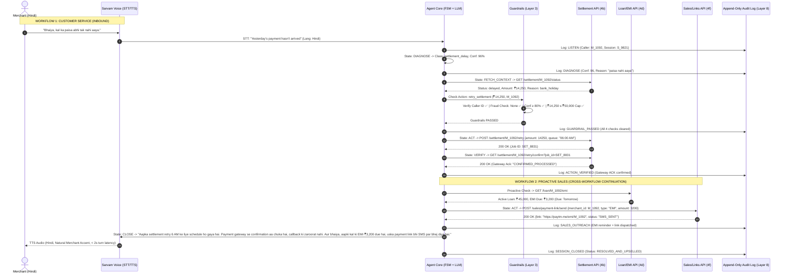

### 12.2 Standalone CS Flow (Soundbox Replacement)
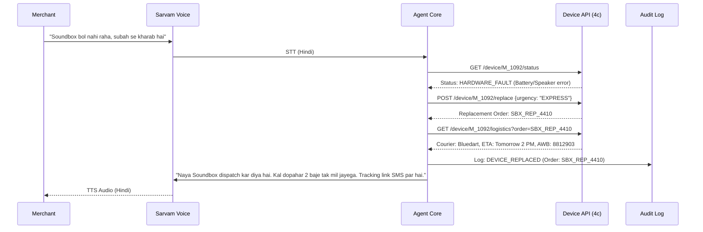

### 12.3 Escalation Flow (Fraud / Hard Limit / Distress)
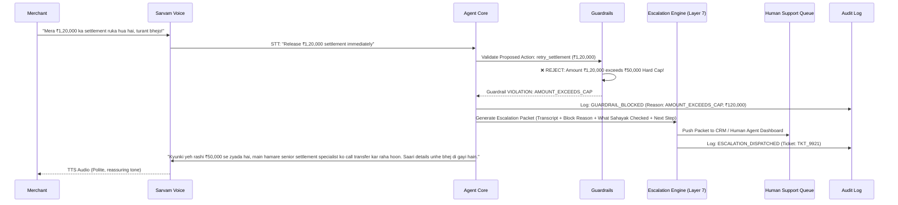

---

## 13. USP ↔ Architecture Traceability

> Complete mapping of every USP claim from **Slide 5** to the architecture layer that fulfills it.

| # | USP Claim | Architecture Layer(s) | Proof |
|---|-----------|----------------------|-------|
| 1 | **Acts Across Systems, Not Just One** — fetches from 6 systems, takes action, confirms | Layer 4 (6 APIs) + Layer 2 (State Machine with ACT + VERIFY states) | Agent calls multiple backend APIs in a single session; VERIFY state confirms outcome |
| 2 | **Safe With Every Rupee** — verified, fraud-checked, capped, confirmed, audit-logged, reversible | Layer 3 (Guardrails G1–G5) + Layer 8 (Audit Log) | 5-gate guardrail pipeline runs before every financial action; append-only audit log |
| 3 | **Escalates Like a Senior Teammate** — human gets summary, what was tried, next action, transcript | Layer 7 (Escalation System) | Escalation packet contains all 4 fields; human **never starts from zero** |
| 4 | **Covers Both Sales and Customer Service** — inbound CS + outbound sales in one framework | Layer 5 (CS) + Layer 6 (Sales) through same Layer 2 (Agent Core) | Single state machine drives both; same guardrails, same audit trail |

---

## 14. Impact & Design Targets

> From **Slide 6** — all targets are measurable via the Evaluation Harness (Layer 9).

| Target | Value | Validated By |
|--------|-------|-------------|
| Routine CS tickets resolved without human | **70%+** | Eval Harness resolution rate metric |
| Unsafe money actions executed | **0** | Eval Harness safety metric + Guardrail Layer |
| Voice response latency per turn | **< 2 seconds** | Sarvam AI pipeline measurement |
| Actions audit-logged | **100%** — zero exceptions | Audit Log immutability + Eval Harness coverage check |

### Beneficiary Impact Map

| Beneficiary | Impact | Architecture Source |
|-------------|--------|-------------------|
| **Merchants** | Issues resolved in seconds, in their language; no callbacks; proactive sales feels like service | Layer 1 (multilingual voice) + Layer 2 (autonomous resolution) + Layer 6 (proactive sales) |
| **Paytm** | Servicing cost curve bends (₹339 Cr/quarter); faster EMI follow-up; better device retention | Layer 5 (CS automation) + Layer 6 (Sales) + Layer 4d/4c (Loan & Device APIs) |
| **Support Teams** | Routine tickets handled autonomously; escalated cases arrive complete; focus on complex cases | Layer 5 (auto-resolution) + Layer 7 (full-context escalation) |

---

## 15. Business Model Alignment

> From **Slide 7** — how the architecture supports each business lever.

| Business Lever | Claim | Architecture Support |
|---------------|-------|---------------------|
| **Save** | Target ₹339 Cr/quarter spend; resolve routine tickets autonomously | Layers 2–5 automate highest-volume categories (settlement 40%, Soundbox 25%, payments 20%, EMI/KYC 15%) |
| **Earn** | Proactive EMI follow-up, payment nudges, Soundbox retention | Layer 6 (Sales Workflows) converts support interactions into retention events |
| **Scale** | Same multilingual voice + multi-system framework → B2B platform | Layer 1 (Sarvam AI — language agnostic) + Layer 4 (pluggable API surface) = portable to any fintech |
| **Pricing** | ₹5–15 per resolved ticket (outcome-based) | Layer 8 (Audit Log) provides verifiable per-ticket resolution records for billing |
| **Market** | 5 Cr × ₹10/ticket × 30% = ₹150 Cr+ annual inside Paytm | Layer 9 (Eval Harness) validates resolution rate to prove addressable volume |
| **Pilot path** | Settlement + Soundbox first; human approval on money actions; widen as metrics hold | Guardrail Layer (Layer 3) enforces human approval gates; Eval Harness (Layer 9) tracks metrics for expansion decisions |

---

## 16. Directory Structure

```
Sahayak/
├── architecture.md              # ← This document
├── task.md                      # Implementation checklist (111 items)
├── Sahayak_Paytm_Power_Rangers_V2.pptx  # Presentation deck
│
├── voice/                       # Layer 1 — Sarvam AI integration
│   ├── stt.py                   # Speech-to-Text client
│   ├── tts.py                   # Text-to-Speech client
│   └── language_detect.py       # Auto language detection
│
├── agent/                       # Layer 2 — Agent Core
│   ├── state_machine.py         # 6-state FSM controller
│   ├── llm_client.py            # Sarvam AI LLM + tool calling
│   ├── confidence.py            # Confidence scorer
│   ├── reasoning_trace.py       # Reasoning trace logger
│   └── conversation.py          # Multi-turn conversation handler
│
├── guardrails/                  # Layer 3 — Safety by Design
│   ├── pipeline.py              # Guardrail pipeline orchestrator
│   ├── amount_cap.py            # ₹50K hard cap enforcer
│   ├── caller_verify.py         # Caller ID verification
│   ├── fraud_check.py           # Fraud flag pre-check
│   └── confidence_gate.py       # Confidence threshold gate
│
├── mock_backend/                # Layer 4 — 6 Paytm Mock APIs
│   ├── merchant_kyc.py          # 4a: Merchant Profile & KYC
│   ├── settlement.py            # 4b: Settlement & Payment Gateway
│   ├── device_logistics.py      # 4c: Device & Logistics (Soundbox)
│   ├── loan_emi.py              # 4d: Loan & EMI Management
│   ├── crm_ticketing.py         # 4e: CRM & Ticketing
│   ├── sales_outreach.py        # 4f: Sales Outreach & Payment Links
│   └── mock_data.py             # Seed data for all mock systems
│
├── workflows/                   # Layers 5 & 6 — Workflows
│   ├── cs/                      # Layer 5 — CS Workflows
│   │   ├── settlement_delay.py  # 5a: Settlement delays
│   │   ├── soundbox_failure.py  # 5b: Soundbox failures
│   │   ├── failed_payment.py    # 5c: Failed/missing payments
│   │   └── emi_kyc.py           # 5d: EMI & KYC issues
│   └── sales/                   # Layer 6 — Sales Workflows
│       ├── emi_reminder.py      # Proactive EMI reminder
│       ├── usage_nudge.py       # Low usage nudge
│       └── loan_followup.py     # Loan follow-up
│
├── escalation/                  # Layer 7 — Escalation System
│   ├── triggers.py              # Escalation trigger rules
│   ├── packet.py                # Escalation packet generator
│   └── human_endpoint.py        # Mock human agent endpoint
│
├── audit/                       # Layer 8 — Audit Log
│   ├── writer.py                # Append-only audit writer
│   ├── schema.py                # Log entry schema
│   └── viewer.py                # Read-only audit viewer (for demo)
│
├── eval/                        # Layer 9 — Evaluation Harness
│   ├── runner.py                # Test runner script
│   ├── scenarios/               # Scripted test scenarios
│   │   ├── cs_scenarios.json    # ≥10 CS scenarios
│   │   ├── sales_scenarios.json # ≥3 Sales scenarios
│   │   ├── escalate_scenarios.json # ≥5 must-escalate
│   │   └── refuse_scenarios.json   # ≥2 must-refuse
│   └── metrics.py               # Metrics calculator & reporter
│
└── demo/                        # Demo Preparation
    ├── demo_cs_settlement.py    # Primary: settlement delay → retry → confirm
    ├── demo_sales_emi.py        # Secondary: proactive EMI outreach
    └── demo_escalation.py       # Escalation: fraud → human handoff
```

---

> [!IMPORTANT]
> **Every claim from the PPT is architecturally backed.** Each layer has a dedicated section with a claim traceability table that maps PPT quotes → architecture components → how the claim is fulfilled. No claim is left unsubstantiated.

---

*Architecture document generated from `Sahayak_Paytm_Power_Rangers_V2.pptx` (7 slides) and `task.md` (111-item checklist).*
*Team Paytm Power Rangers — Lankipalli Tharun · Radhika Tenali*

