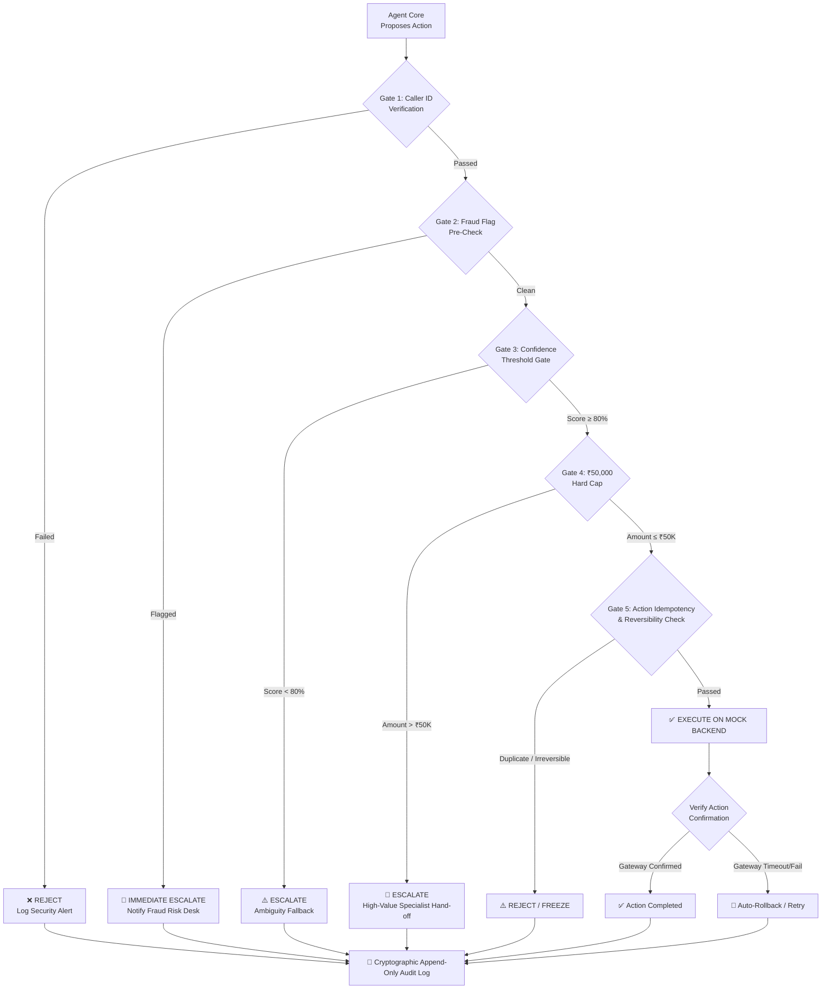

# Sahayak — Guardrails, Safety & Audit Protocol

### Team Paytm Power Rangers | Lankipalli Tharun · Radhika Tenali
### Paytm AI Hackathon · Track 3: Autonomous AI Teammates

> **"Safe With Every Rupee · 0 Unsafe Money Actions Executed · 100% Audit Coverage"**
> *Specification for Layer 3 (Guardrails) and Layer 8 (Append-Only Audit Log).*

---

## 1. Safety Philosophy: "Feature, Not a Fallback"

In fintech, an AI teammate that executes an unverified transaction or hallucinates an unauthorized refund is disastrous.
In Sahayak, **safety is not a system prompt instruction — it is hard-coded in deterministic software gates.**

> **PPT Claim (Slide 3):** *"Sahayak knows when NOT to act — that's a feature, not a fallback."*
> **PPT Claim (Slide 5 — USP #2):** *"Safe With Every Rupee: Caller verified, fraud checked, amount capped, action confirmed — before every financial move. Audit-logged. Reversible where possible."*



---

## 2. The 5 Deterministic Guardrail Gates

### Gate 1: Caller ID & Merchant Authentication Gate
* **Enforcement:** Pre-flight check before any data retrieval or action.
* **Rule:** Incoming caller MSISDN (Phone number) must map directly to an active, non-suspended merchant record in the database.
* **Deterministic Code Logic:**
  ```python
  def verify_caller_identity(caller_phone: str, merchant_id: str) -> bool:
      merchant = db.get_merchant(merchant_id)
      if not merchant or merchant.phone != caller_phone:
          audit_log.append("AUTH_FAILURE", f"Caller {caller_phone} mismatch with {merchant_id}")
          raise SecurityException("MERCHANT_IDENTITY_MISMATCH")
      return True
  ```

### Gate 2: Fraud & Risk Flag Pre-Check
* **Enforcement:** Checked before ANY mutation, refund, retry, or link generation.
* **Rule:** If `merchant.is_fraud_flagged == True` or `merchant.risk_score > 75` or `merchant.active_disputes > 0`:
  * **Zero financial action allowed.**
  * Immediate synthesis of an Escalation Packet.
  * Transfer to Human Risk Desk.

### Gate 3: Confidence Threshold Gate ($\ge 80\%$)
* **Enforcement:** Applied at `DIAGNOSE` state.
* **Rule:** The LLM's classification confidence must be numerically $\ge 80/100$.
* **Rationale:** An AI teammate must never guess when moving money. If the merchant's speech is garbled or contradictory, Sahayak politely explains the ambiguity and transfers the merchant to a human teammate.

### Gate 4: ₹50,000 Hard Limit Cap
* **Enforcement:** Non-configurable hard threshold in code.
* **Rule:**
  $$\text{Action Amount} \le ₹50,000.00$$
* **Deterministic Code Logic:**
  ```python
  HARD_CAP_INR = 50000.00

  def check_amount_cap(action_type: str, amount_inr: float) -> bool:
      if amount_inr > HARD_CAP_INR:
          raise GuardrailViolation(
              code="EXCEEDS_HARD_CAP",
              message=f"Requested {amount_inr} exceeds non-negotiable limit of {HARD_CAP_INR}"
          )
      return True
  ```
* **Failure Handling:** Auto-generates Escalation Packet with priority routing.

### Gate 5: Idempotency & Reversibility Check
* **Enforcement:** Prevents duplicate retries and double deductions.
* **Rule:** Every action carries an `Idempotency-Key` (e.g., `hash(merchant_id, date, amount)`). If an action with the same key was executed in the last 24 hours, the duplicate attempt is blocked.
* **Reversibility:** All mock settlement retry jobs enter a `QUEUED` state with a 15-minute cancellation window, allowing operators or users to cancel before settlement clearance.

---

## 3. Layer 8: Append-Only Immutable Audit Log Specification

> **PPT Claim (Slide 6):** *"100% of actions audit-logged — zero exceptions."*

To prove to hackathon judges that no action can bypass logging, the audit trail uses **Cryptographic Hash-Chaining** (similar to a blockchain ledger or Git tree). Each entry includes the SHA-256 hash of the previous record.

### 3.1 Audit Block Schema

```json
{
  "index": 142,
  "timestamp": "2026-10-29T16:20:01.892+05:30",
  "prev_hash": "e3b0c44298fc1c149afbf4c8996fb92427ae41e4649b934ca495991b7852b855",
  "session_id": "SESS_98214",
  "merchant_id": "M_1092",
  "event_type": "ACTION_EXECUTED",
  "state": "ACT",
  "details": {
    "action": "settlement_retry",
    "amount_inr": 14250.00,
    "guardrails_evaluated": {
      "caller_verified": true,
      "fraud_flag": false,
      "confidence_score": 96,
      "under_50k_cap": true
    },
    "result": "QUEUED_JOB_77812",
    "gateway_ack": "CONFIRMED_200"
  },
  "hash": "4a5e1e4baab89f3a32518a88c31bc87f618f76673e2cc77ab2127b7afdeda33b"
}
```

### 3.2 Audit Log Event Types
1. `CALL_INBOUND`: Merchant initiated session; language detected.
2. `DIAGNOSIS_COMPLETED`: Category classified + confidence score.
3. `GUARDRAIL_EVALUATION`: Details of all 5 gates passed or failed.
4. `GUARDRAIL_VIOLATION`: Specific rule triggered and blocked.
5. `ACTION_EXECUTED`: API call made to Paytm mock backend.
6. `ACTION_VERIFIED`: Gateway confirmation received.
7. `SALES_OUTREACH`: Proactive link or nudge dispatched.
8. `ESCALATION_TRIGGERED`: Packet sent to human queue.
9. `CALL_COMPLETED`: Session closed with outcome code.

---

## 4. The Senior Teammate Escalation Protocol (Layer 7)

> **PPT Claim (Slide 5 — USP #3):** *"Escalates Like a Senior Teammate: Human receives: issue summary, what Sahayak tried, next recommended action, full transcript. The human never starts from zero."*

### 4.1 Escalation Packet JSON Contract
When an escalation fires, this structured packet is sent to the Human Support Desk:

```json
{
  "escalation_id": "ESC_20261029_0912",
  "timestamp": "2026-10-29T16:21:40+05:30",
  "merchant_info": {
    "merchant_id": "M_8819",
    "name": "Vikram Singh",
    "phone": "+919811223344",
    "tier": "PLATINUM"
  },
  "trigger_reason": "AMOUNT_EXCEEDS_50K_CAP",
  "issue_summary": "Merchant is requesting immediate unholding and retry of a ₹1,20,000 settlement batch from 28-Oct.",
  "what_sahayak_tried": [
    {
      "step": 1,
      "action": "VERIFY_CALLER",
      "outcome": "PASSED (+919811223344 matched)"
    },
    {
      "step": 2,
      "action": "FETCH_SETTLEMENT_STATUS",
      "outcome": "FOUND (Amount: ₹1,20,000, Status: RISK_HOLD)"
    },
    {
      "step": 3,
      "action": "EVALUATE_RETRY_GUARDRAIL",
      "outcome": "BLOCKED (₹1,20,000 exceeds ₹50,000 hard limit)"
    }
  ],
  "next_recommended_action": "Contact Axis Bank Nodal Officer (Desk 4) to verify manual batch clearance token #AXS991.",
  "full_transcript": [
    {"speaker": "MERCHANT", "text": "Mera ek lakh bees hazaar ka settlement ruka hai, turant account mein daalo!"},
    {"speaker": "SAHAYAK", "text": "Main aapka account check kar raha hoon Vikram ji... Main dekh sakta hoon ₹1,20,000 ki rashi ruki hui hai."},
    {"speaker": "SAHAYAK", "text": "Yeh rashi hamare automated limit se upar hai, isliye main turant hamare senior settlement specialist ko transfer kar raha hoon."}
  ],
  "priority": "HIGH"
}
```

---

*This specification guarantees that Sahayak satisfies the "0 Unsafe Actions" and "100% Audit Logged" criteria on Slide 6.*

